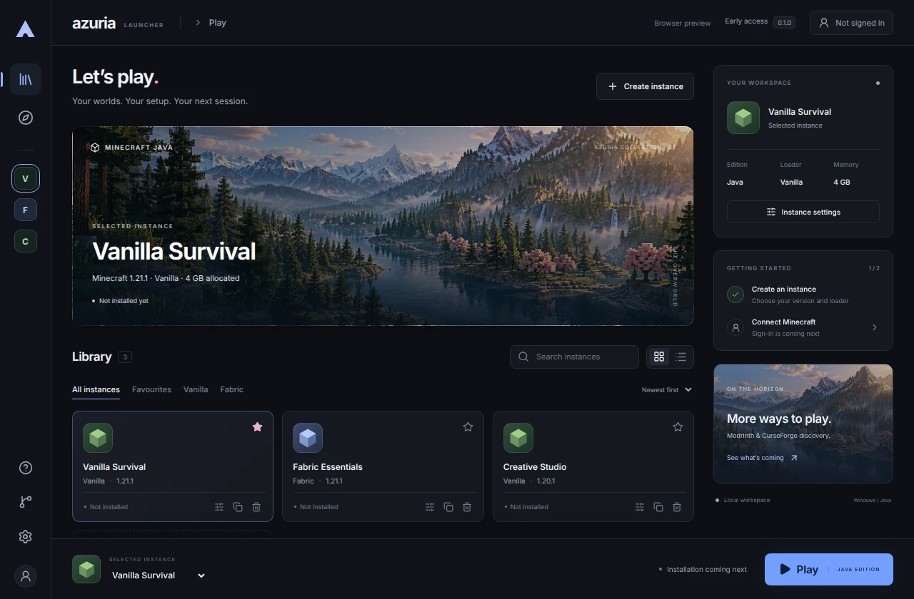

# Azuria Launcher

A Windows-first Minecraft Java launcher in development, built with Vue, TypeScript, Tauri and Rust.

Azuria brings Vanilla and Fabric instance settings into a local library, with a compact interface, pink and blue accents, and dark, light and system themes.



_Interface preview with example instances. New installations start with an empty library._

## Project status

Azuria is an early development project. **Minecraft sign-in, game installation and launching are not available yet.** The current build establishes the desktop interface, local storage and update system.

### Available now

- Create and edit instance settings for Vanilla and Fabric.
- Copy instance settings into a new, empty instance.
- Search, sort, group and favourite instances.
- Remove instances while retaining their files in local trash.
- Recover interrupted removals automatically at startup.
- Save appearance preferences locally.
- Check for and install signed updates in updater-enabled Windows builds.

Instance version IDs are syntax-checked; availability is not checked against the Minecraft catalogue yet. Selecting Fabric stores a preference and does not install Fabric.

### Planned

Microsoft authentication, verified Minecraft and Java downloads, game launching, Fabric installation, and Modrinth and CurseForge integration. See the [development plan](docs/PLAN.md) for the broader direction.

## Development

### Requirements

- Windows with WebView2.
- Node.js 24.
- Current stable Rust (1.89 or newer).
- Visual Studio Build Tools with **Desktop development with C++**.

See the [Tauri prerequisites](https://v2.tauri.app/start/prerequisites/) for native build requirements.

### Run the desktop app

```powershell
npm ci
npm run desktop:dev
```

### Run the browser preview

```powershell
npm ci
npm run dev
```

Open [localhost:1420](http://localhost:1420). The preview stores its own data in the browser and does not share the desktop library or support desktop updates.

### Build a Windows installer

```powershell
npm run desktop:build
```

The NSIS installer is written to `src-tauri/target/release/bundle/nsis/`. Local builds are development installers and are not Windows Authenticode signed.

## Architecture

| Layer               | Technology                | Responsibility                                                |
| ------------------- | ------------------------- | ------------------------------------------------------------- |
| Interface           | Vue, TypeScript and Pinia | Instance library, settings and update controls                |
| Desktop integration | Tauri                     | Native commands, window controls and updater                  |
| Storage             | Rust and SQLite           | Validated instance settings, migrations and deletion recovery |

Desktop data stays in the application's local data directory. Instance directories use generated UUIDs rather than user-entered names. There is no analytics or log-upload service in the current build.

## Storage and recovery

Removing an instance moves its files to a local trash directory. It does not permanently erase worlds or mods. Copying settings does not copy those files.

A deletion journal records each removal. If the app closes before removal completes, the next startup restores the instance. Completed removals retain their settings and trash location in the database. Conflicting folders are left untouched and reported with recovery instructions.

There is no restore interface yet. See [storage recovery](docs/RECOVERY.md) before attempting manual restoration. Back up the entire application data directory with Azuria closed, including the database, instance folders and trash.

## Updates

Updater-enabled Windows builds check for updates at startup. Installation starts only after selecting **Update & restart**. Downloads are verified against the public signing key bundled with the app.

Update signatures and Windows Authenticode signing are separate: development installers can support verified updates while still appearing unsigned to Windows.

GitHub Actions can publish signed development releases when explicitly enabled by the maintainer. See [update configuration](docs/UPDATES.md) for setup and release details.

## Checks

```powershell
npm run build
npm test
npx playwright install chromium
npm run test:e2e
cargo test --locked --manifest-path crates/azuria-core/Cargo.toml
cargo clippy --locked --manifest-path crates/azuria-core/Cargo.toml --all-targets -- -D warnings
cargo test --locked --manifest-path src-tauri/Cargo.toml
cargo clippy --locked --manifest-path src-tauri/Cargo.toml --all-targets -- -D warnings
```

GitHub Actions runs frontend checks and native Windows checks. Browser tests exercise the preview; real installation and update behaviour also require Windows smoke testing.

## Further reading

- [Architecture](docs/ARCHITECTURE.md)
- [Design and asset provenance](docs/DESIGN.md)
- [External integrations](docs/INTEGRATIONS.md)
- [Development plan](docs/PLAN.md)

## Licence

A project licence has not been selected. Dependency and asset licences remain applicable; see the linked provenance and integration documents.
